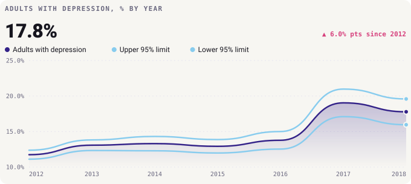
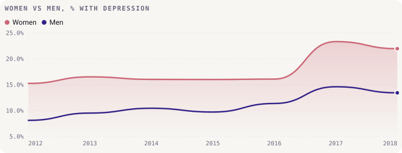
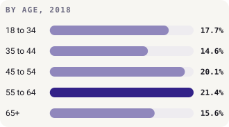
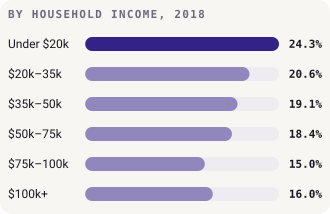
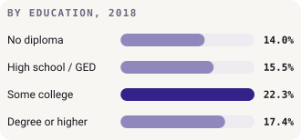
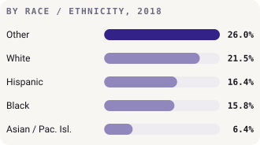
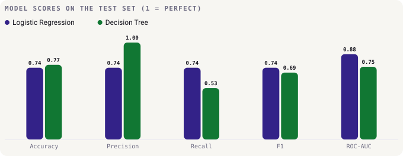

# 🧠 Adult Depression Indicator Analysis

How common is depression among adults in California, who is most affected, and has it changed? This project explores the **Adult Depression (LGHC Indicator 24)** dataset published by the [California Department of Public Health](https://www.cdph.ca.gov/) (2012–2018), then tests whether a group's year and demographics alone can flag it as a high-depression group.

## 🗂️ Data source and credit

- **Dataset:** [Adult Depression (LGHC Indicator)](https://catalog.data.gov/dataset/adult-depression-lghc-indicator) on DATA.GOV, hosted on the [California Health and Human Services Open Data Portal](https://data.chhs.ca.gov/)
- **Publisher:** California Department of Public Health (CDPH)
- **Survey:** California Behavioral Risk Factor Surveillance Survey (BRFSS), an annual telephone survey run for CDPH by the Public Health Survey Research Program at California State University, Sacramento
- **What it measures:** the share of adults who have ever been told by a doctor, nurse or other health professional that they have a depressive disorder
- **Part of:** [Let's Get Healthy California](https://letsgethealthy.ca.gov/), where this is Indicator 24
- **Licence:** [Creative Commons Attribution (CC BY)](http://www.opendefinition.org/licenses/cc-by)

The data was collected and published by CDPH and the BRFSS team, and I'm grateful for their work in making it openly available. CDPH notes that its weighting uses California Department of Finance population figures rather than the U.S. Census, so the numbers may differ from national BRFSS tables. The analysis and charts in this repo are my own and are not endorsed by CDPH.

## 🔍 Key findings

**About 1 in 6 adults reported depression in 2018, up from about 1 in 8 in 2012.** The rate held steady at 12–14% until 2016, then jumped in 2017. A one-year jump that size is worth checking against the survey's notes before reading it as a real change.



**Women report depression far more often than men**, by roughly 5–9 percentage points every year.



**Rates are highest in the lowest-income households and among 55–64 year olds** (2018). The darkest bar in each tile is the highest group.

<p>
  
  
</p>
<p>
  
  
</p>

## 🤖 Modelling

**Target:** `HighDepression` = 1 when a group's `Percent` is above the median.

**Features:** only the **year** and the **group** (e.g. "Female", "$100k+"). An earlier version also used the 95% confidence limits and the case counts. Those are worked out from the answer itself, so the model could simply read it off them (target leakage). They're now left out, and the `Total` rows are dropped because they're an average of the other rows.

Both models run inside a scikit-learn `Pipeline` (scaling + one-hot encoding), with a stratified 75/25 train/test split.



- **Logistic regression** is the better all-rounder (ROC-AUC 0.88).
- **Decision tree** (depth 4) never raises a false alarm but misses about half the high-depression groups.
- With only 154 rows, the test set is small (39 rows), so treat these scores as a rough guide.

## 📊 Charts

All charts are made with my Python library, [**Bezel Charts**](https://pypi.org/project/bezel-charts/) ([GitHub](https://github.com/ShazMoghaddam/bezel-charts)). They use a light, frameless style on a warm off-white background, with Paul Tol's colour-blind-safe "muted" palette: indigo `#332288`, rose `#CC6677`, green `#117733` and pale cyan `#88CCEE`. The chart code is in [`charts.py`](charts.py).

## 📂 Project structure

```text
├── Adult Depression Data Analysis.ipynb   # analysis and modelling
├── charts.py                              # Bezel Charts style and chart functions
├── charts/                                # rendered SVG charts
├── adult-depression-lghc-indicator-24.csv # source data
└── requirements.txt
```

## ▶️ Run it

```bash
pip install -r requirements.txt
jupyter notebook "Adult Depression Data Analysis.ipynb"
```

Running the notebook from top to bottom regenerates every chart in `charts/`.

---

Created by **Shaz Moghaddam** · London
[Website](https://shazmoghaddam.github.io) · [LinkedIn](https://www.linkedin.com/in/shazmoghaddam)
