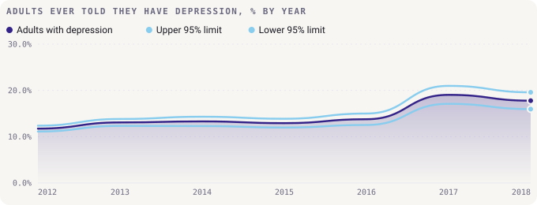
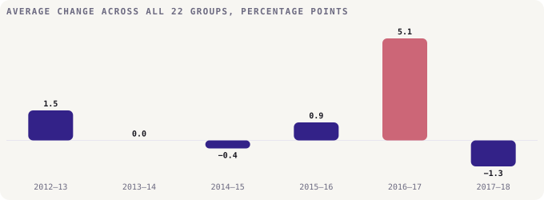
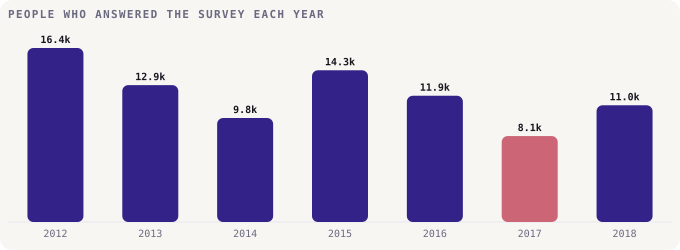
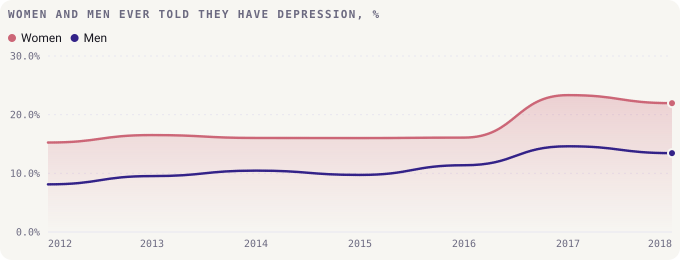
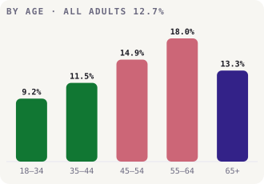
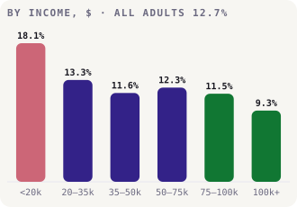
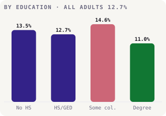
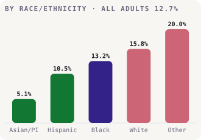
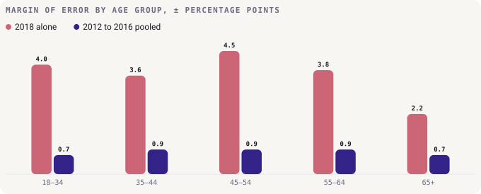

# Findings

How common depression is among adults in California, who is most affected, and what changed, from 2012 to 2018.
This page is written by [`build.py`](build.py), so every number comes straight from the data.

The figures are the share of adults who have **ever been told** by a doctor, nurse or other health professional that
they have a depressive disorder, from the California Behavioral Risk Factor Surveillance Survey. That depends on people
seeing a professional and being diagnosed, so it isn't the same as how many people have depression.

## 1. About 1 in 8 adults, and steady until 2016

From 2012 to 2016 the rate stayed between 11.7% and 13.8%. Pooled over those five years it was **12.7%**,
about 1 in 8 adults.

## 2. The 2017 jump looks like a change in the survey, not in people

In 2017 the rate rose 5.3 points in a year, to 19.0%, and stayed high in 2018 at 17.8%. Several things suggest the survey
changed rather than Californians' health:

- **Every group rose at once, and by a lot.** All 22 groups went up, by between 1.7 and 9.9 points. The average
  rise was 5.1 points. In no other year did the average move by more than 1.5.
- **The survey was smaller.** Working back from the counts, 8,141 people answered in 2017, the fewest of any year, against
  16,354 in 2012.
- **The uncertainty tripled.** The margin of error on the overall rate was ±0.6 points in 2012 and ±1.9 in 2017.
- **The scaled-up count leapt.** Adults with depression, scaled up to California's population, went from 3.8 million to
  5.3 million in a year, up 38%.

The California Department of Public Health's notes don't record a change in method that year, so the data can't say what
happened. It may be a real rise. But until that's confirmed, 2017 and 2018 shouldn't be compared directly with earlier
years, and the group comparisons below use 2012 to 2016.

## 3. Women report depression far more often than men

Women's rate was higher than men's in every year, by 4.7 to 8.7 points, and the confidence intervals never overlap. Over 2012
to 2016, 15.9% of women had been told they have depression against 9.3% of men.

Part of this gap may be that women are more likely to see a doctor and be diagnosed. The data can't separate the two.

## 4. Depression rises with age until 65

Pooled over 2012 to 2016, the rate climbs from 9.2% among 18–34 year olds to **18.0%** at 55–64, then falls to 13.3% at 65
and over. Rose bars are clearly above all adults (12.7%), green clearly below, and indigo can't be told apart.

## 5. Lower income, more depression

Households earning under $20,000 had a rate of **18.1%**, about double the 9.3% in households earning $100,000 or more. The gap
is clear in 6 of 7 years on their own. By education, adults with some college had the highest rate (14.6%) and graduates
the lowest (11.0%).

  
  

## 6. Asian and Pacific Islander adults report the least depression

Asian and Pacific Islander adults had the lowest rate in every year, 5.1% pooled over 2012 to 2016. Hispanic adults were also below
average (10.5%), Black adults close to it (13.2%), and White adults (15.8%) and those recorded as "Other" (20.0%) above.

Diagnosis depends on seeking care, which differs between communities, so these gaps may partly reflect who gets diagnosed.

## 7. One year of data can't rank the groups

Each group in each year rests on a few hundred answers, so single-year figures carry wide margins of error: ±2.2 to
±4.5 points for the age groups in 2018. Pooling five years cuts that to ±0.7 to ±0.9.

In 2018 alone, none of the 10 pairs of age groups can be told apart. Pooled, 9 can. The same is true of the earlier
version's model: with only 154 group-year rows and nothing but the year and the group to go on, it was mostly memorising
which groups are high, which the confidence intervals already show directly. It's been replaced by the comparisons above.

## What this data can't tell you

- **How many people have depression.** It counts people who have been diagnosed, which depends on access to care.
- **What happened in 2017.** The signs point to the survey, but the published notes don't say.
- **Anything about individuals.** These are group averages from a weighted survey.
- **Causes.** Income, age or ethnicity going with higher rates doesn't show that they cause them.

## How it was worked out

1. [`data/adult_depression_lghc_indicator_24.csv`](../data/adult_depression_lghc_indicator_24.csv) is the published file, unchanged.
2. [`analysis.py`](analysis.py) holds every calculation as a small, tested function. Standard errors are worked back from the published
   95% confidence limits, and years are pooled by inverse-variance weighting, which gives more weight to years measured more precisely.
3. [`charts.py`](charts.py) draws each chart with [bezel-charts](https://pypi.org/project/bezel-charts/).
4. [`notebooks/depression_analysis.ipynb`](../notebooks/depression_analysis.ipynb) walks through the same steps with the working shown.

Pooling assumes each group's rate was roughly steady from 2012 to 2016, which the overall rate supports.

## A correction to the earlier version

The earlier version named 55–64 year olds and adults with some college as the highest groups in 2018. Their rates were the
highest that year, but neither can be told apart from most other groups on 2018 alone. Five years pooled confirm both
patterns. It also read 2017 as a possible real rise and ran a classifier on 154 rows. Everything here replaces that work.
